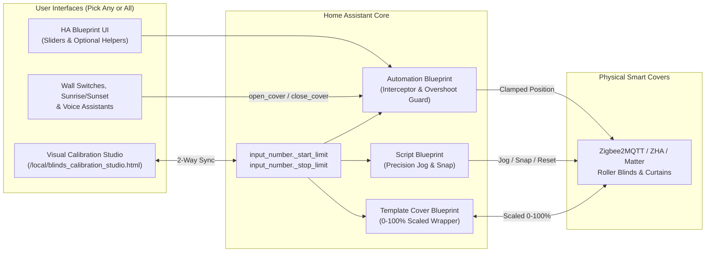

# 🪟 Home Assistant Blind & Curtain Calibration Studio (Blueprints + Visual Console)

[](LICENSE)
[](https://www.home-assistant.io/)
[](#1-click-blueprint-import)

> Software start/stop limit calibration, overshoot clamping, precision motor nudging (`+5% / +1% / STOP / -1% / -5%`), 1-tap live position snapping, calibrated virtual covers, and an optional zero-config visual window simulator panel for **any** Home Assistant `cover` entity (Zigbee2MQTT, ZHA, Matter, Aqara, Tuya, Zemismart, IKEA, SwitchBot, Shelly, ESPHome).

---

## 🚀 1-Click Blueprint Import

Click the badges below to import the blueprints directly into your Home Assistant instance:

### 1. Automation Blueprint — Limit Calibration, Open/Close Interceptor & Overshoot Guard
[](https://my.home-assistant.io/redirect/blueprint_import/?blueprint_url=https%3A%2F%2Fgithub.com%2FJBGITHUB12%2Fha-blinds-calibration-studio%2Fblob%2Fmain%2Fblueprints%2Fautomation%2FJBGITHUB12%2Fblind_curtain_calibration_studio.yaml)

**Manual Import URL:**
```text
https://github.com/JBGITHUB12/ha-blinds-calibration-studio/blob/main/blueprints/automation/JBGITHUB12/blind_curtain_calibration_studio.yaml
```

### 2. Script Blueprint — Precision Jog (`+5% / +1% / STOP / -1% / -5%`), Midpoint & Snap Controller
[](https://my.home-assistant.io/redirect/blueprint_import/?blueprint_url=https%3A%2F%2Fgithub.com%2FJBGITHUB12%2Fha-blinds-calibration-studio%2Fblob%2Fmain%2Fblueprints%2Fscript%2FJBGITHUB12%2Fblind_curtain_precision_jog.yaml)

**Manual Import URL:**
```text
https://github.com/JBGITHUB12/ha-blinds-calibration-studio/blob/main/blueprints/script/JBGITHUB12/blind_curtain_precision_jog.yaml
```

### 3. Template Cover Blueprint — `0–100%` Soft-Limit Calibrated Virtual Cover
Copy [`blueprints/template/JBGITHUB12/calibrated_cover_wrapper.yaml`](blueprints/template/JBGITHUB12/calibrated_cover_wrapper.yaml) to `/config/blueprints/template/JBGITHUB12/calibrated_cover_wrapper.yaml` to create virtual `cover` entities whose `0%` and `100%` endpoints map linearly onto your physical `[Stop Limit .. Start Limit]` span.

---

## ✨ Why Use This Suite?

Many smart roller blind and curtain motors suffer from frustrating physical calibration quirks:
- **Overshooting top headers or pooling fabric on windowsills** when `cover.open_cover` (`100%`) or `cover.close_cover` (`0%`) is triggered by wall switches, sunrise/sunset routines, or voice assistants (*"Close the blinds"*).
- **Awkward physical button dances** required to set or reset internal motor end-stops on ceiling-mounted tubes.
- **Coarse dashboard sliders** that make nudging a blind by `1%` to align paired windows nearly impossible on mobile touchscreens.

This repository solves all three natively inside Home Assistant:

| Component | What It Does |
| :--- | :--- |
| **Automation Blueprint**<br>`blind_curtain_calibration_studio.yaml` | Intercepts `cover.open_cover` & `cover.close_cover` calls and redirects to your calibrated Start/Stop percentages; clamps manual overshoots after a configurable settle delay; binds optional `input_number` & `input_button` helpers for 1-tap **"Set Current as Limit"**, `+5% / +1% / STOP / -1% / -5%` nudging, Midpoint, motor direction polarity sync, Sunrise/Sunset scheduling, and low-battery alerts. |
| **Script Blueprint**<br>`blind_curtain_precision_jog.yaml` | Exposes a single reusable script per blind (or blind group) with a 12-action dropdown (`open_to_limit`, `midpoint`, `close_to_limit`, `jog_up_5`, `jog_up_1`, `stop`, `jog_down_1`, `jog_down_5`, `snap_start_limit`, `snap_stop_limit`, `toggle_reverse_direction`, `z2m_hardware_reset`). |
| **Template Blueprint**<br>`calibrated_cover_wrapper.yaml` | Creates a clean `0%–100%` Home Assistant `cover` entity mapped smoothly across `[stop_limit .. start_limit]`, ideal for exposing to Apple HomeKit, Google Home, or Alexa. |
| **Visual Calibration Studio**<br>`www/blinds_calibration_studio.html` | Optional single-file HTML5/CSS3 visual console for `/config/www/`. Auto-authenticates via your active Home Assistant session, auto-discovers every `cover.*` entity and Home Assistant Area, renders an interactive animated window with live `TOP` / `BTM` limit markers, 1-click **Sync HA Helpers**, and instant Blueprint YAML export. |

---

## 🏗️ Architecture



---

## 🖥️ Optional: Installing the Visual Calibration Studio Panel

1. Copy [`www/blinds_calibration_studio.html`](www/blinds_calibration_studio.html) into your Home Assistant `/config/www/` folder (create the `www` folder if it does not exist, then restart Home Assistant once if `www` was newly created).
2. In Home Assistant, go to **Settings → Dashboards → Add Dashboard → Webpage** (or add a **Webpage Card** to an existing dashboard):
   - **Title:** `Blinds Studio`
   - **Icon:** `mdi:blinds-horizontal`
   - **URL:** `/local/blinds_calibration_studio.html`
3. Open **Blinds Studio** from your sidebar:
   - All `cover.*` entities, rooms/areas, battery levels, temperatures, and motor states are discovered automatically.
   - Click **Sync HA Helpers** in the top bar to automatically create `input_number.<cover>_start_limit` and `input_number.<cover>_stop_limit` helpers in Home Assistant with 1 click.
   - Jog any blind to the exact upper/lower edge you want and click **Set Current** — your Home Assistant helpers update immediately.
   - Click **Export Blueprint YAML** to copy ready-made Blueprint configurations for your covers.

---

## 📂 Repository Contents

- [`blueprints/automation/JBGITHUB12/blind_curtain_calibration_studio.yaml`](blueprints/automation/JBGITHUB12/blind_curtain_calibration_studio.yaml) — Main Automation Blueprint
- [`blueprints/script/JBGITHUB12/blind_curtain_precision_jog.yaml`](blueprints/script/JBGITHUB12/blind_curtain_precision_jog.yaml) — Precision Jog & Snap Script Blueprint
- [`blueprints/template/JBGITHUB12/calibrated_cover_wrapper.yaml`](blueprints/template/JBGITHUB12/calibrated_cover_wrapper.yaml) — Soft-Limit Template Cover Blueprint
- [`www/blinds_calibration_studio.html`](www/blinds_calibration_studio.html) — Auto-discovering Visual Window Calibration Studio Web Panel
- [`examples/helpers_and_template_example.yaml`](examples/helpers_and_template_example.yaml) — Example YAML package
- [`examples/lovelace_calibration_card.yaml`](examples/lovelace_calibration_card.yaml) — Native Lovelace Tile + Jog button card example

---

## 📄 License

Released under the [MIT License](LICENSE). Free for everyone to use, modify, and share.
